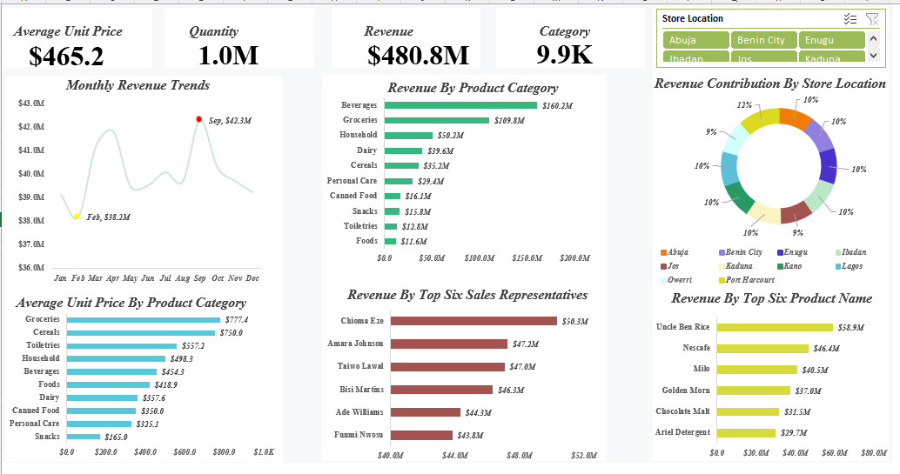

# Supermarket Sales Analysis and Dashboard Development Using Excel

## Project Overview

This project analyzes a supermarket sales dataset using
Microsoft Excel. The objective was to clean and validate the data,
examine sales performance across different business dimensions, and
build a dashboard to communicate key findings.

The analysis focuses on revenue trends, product and category
performance, store-level contributions, and sales-representative
performance.

## Dashboard Preview

## Tools Used

-   Microsoft Excel
-   Excel formulas
-   PivotTables
-   Charts and dashboard design

## Business Questions

-   What are the overall sales revenue and sales volume?
-   Which product categories and products generate the most revenue?
-   How does revenue vary by month?
-   How is revenue distributed across store locations?
-   Which sales representatives generate the highest revenue?
-   What additional data would be needed to assess profitability?

## Data Cleaning and Preparation

The original dataset contained 10,000 records. The cleaning process
included:

1.  Identifying and removing entirely duplicated rows while retaining
    the original dataset for review.
2.  Handling missing values using the relationship between quantity,
    unit price, and total sales when sufficient values were available.
3.  Using overall and product-specific averages to impute some missing
    values when multiple fields were missing.
4.  Checking for remaining blank values in selected fields.
5.  Checking that `Sale_ID` values were unique in the cleaned dataset.
6.  Validating the arithmetic relationship between quantity, unit price,
    and total sales.

The cleaned dataset contained 9,940 records. The checked records had no
remaining blanks in the checked fields, no repeated `Sale_ID` values,
and no differences in the tested sales calculations.

**Data-quality limitation:** Average-imputed values are estimates and
may not match the original transaction values. Arithmetic consistency
does not establish that estimated values are historically accurate.

## Analysis and Dashboard

Excel PivotTables and charts were used to compare sales across:

-   Month
-   Product category
-   Product
-   Store location
-   Sales representative
-   Average unit price by product category

## Key Findings

-   Total sales were approximately **\$480.8 million** across **9,940
    cleaned records**.
-   Approximately **1.04 million units** were sold.
-   Beverages generated approximately **\$160.2 million**, and Groceries
    generated approximately **\$109.8 million**. Together, these
    categories contributed about **56.2%** of total sales.
-   Uncle Ben Rice generated approximately **\$58.9 million**, followed
    by Nescafe at **\$46.4 million** and Milo at **\$40.5 million**.
-   September had the highest monthly revenue at approximately **\$42.3
    million**, while February had the lowest at approximately **\$38.2
    million**.
-   Choma Eze was the highest-revenue sales representative shown in the
    dashboard, at approximately **\$50.3 million**.

## Recommendations

1.  Monitor availability and sales trends for leading categories and
    products.
2.  Investigate lower-revenue categories using additional information
    about quantities sold, pricing, availability, and promotions.
3.  Compare high- and low-revenue months to identify patterns that may
    support sales planning.
4.  Compare store and sales-representative performance using consistent
    measures.
5.  Add product costs, profit margins, and inventory information to
    future analysis to evaluate profitability.

## Limitations
-   Imputed values are estimates and may influence totals and
    comparisons.
-   The dataset does not include the cost and inventory information
    needed to calculate actual profitability.

## Conclusion

This project demonstrates an Excel-based data analysis workflow covering
data cleaning, validation, PivotTable analysis, dashboard development,
and business recommendations. It also highlights the importance of
documenting assumptions and data-quality limitations.

## Files

-   `Supermarket_Sales_Analysis.xlsx` --- Excel workbook containing the
    original and cleaned datasets, PivotTables, dashboard, and insights.
-   `README.md` --- Project description and summary of methods and
    findings.
